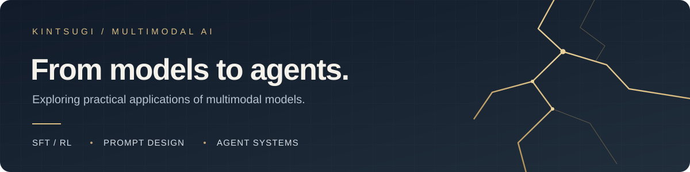

  

<h1 align="center">Hi, I'm Kintsugi</h1>

  Exploring practical applications of multimodal large language models. 
  <b>Model SFT / RL · Prompt Design · Agent Systems</b>

  <a href="#about-me">About</a> ·
  <a href="#selected-projects">Projects</a> ·
  <a href="#currently-exploring">Exploring</a> ·
  <a href="https://github.com/Kintsugi0217?tab=repositories">Repositories ↗</a>

---

## About Me

I'm interested in turning multimodal models into useful applications: adapting models to a task, designing how they are prompted, and connecting them with tools in agent systems.

My current projects explore **e-commerce product understanding**, from lightweight vision-language model fine-tuning to product-tag prompt iteration. I'm also exploring **reinforcement learning for models** and **agent building and optimization**.

> 从模型适配到 Agent 系统，探索多模态大模型如何解决实际问题。

## Focus Areas

| Area | What I'm exploring |
| :--- | :--- |
| **Multimodal Models** | Image-grounded understanding, visual question answering, and domain-specific applications. |
| **Model SFT / RL** | Instruction-data preparation, supervised fine-tuning, and reinforcement learning for task adaptation. |
| **Prompt Design** | Task instructions, context organization, and structured model outputs. |
| **Agent Systems** | Building agents with tools and workflows, and improving how they complete tasks. |

## Selected Projects

### [ProductVLM-Assistant](https://github.com/Kintsugi0217/minimind-v-ecommerce)

A lightweight vision-language model adapted for **e-commerce product understanding and customer-assistant dialogue**, built on MiniMind-V.

- **Tasks:** product descriptions, category and attribute recognition, visual Q&A, and recommendation explanations.
- **Approach:** general multimodal SFT followed by e-commerce SFT using Fashion-Gen images and teacher-generated instruction data.
- **Includes:** data preparation, training, evaluation, and a local Gradio demo.

`Multimodal` `Vision-Language Models` `SFT` `PyTorch`

### [Product Tag Autoresearch](https://github.com/Kintsugi0217/autoresearch_4_PE)

A lightweight experiment loop for iterating **product-tag judgement prompts**.

- **Task:** decide whether a candidate tag matches a product and return a structured answer.
- **Approach:** inspect recurring failure cases, revise prompts, and keep or roll back experimental changes.
- **Includes:** dataset preparation, model-call adapters, and reproducible experiment outputs.

`Prompt Design` `LLM Applications` `Python` `Experimentation`

## Currently Exploring

- **Multimodal applications:** connecting images, language, and domain knowledge.
- **SFT & RL:** improving model behavior for specific tasks.
- **Prompt design:** giving models clearer instructions and useful context.
- **Agents:** combining models, tools, and workflows into systems that can complete tasks.

## Working With

`Python` · `PyTorch` · `Hugging Face Transformers` · `Gradio` · `Git`

---

  <a href="https://github.com/Kintsugi0217">GitHub</a> ·
  <a href="https://github.com/Kintsugi0217?tab=repositories">Explore my projects ↗</a>

<!-- Maintenance notes: add verified Agent/RL projects as they become public. Add a portfolio URL or contact address only after it is ready to share. -->
